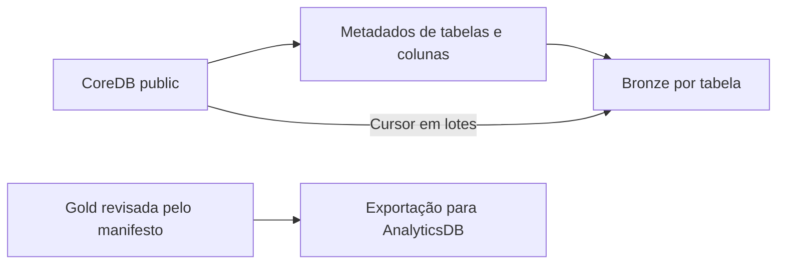

  

# Contrato de entrada e saída

Bronze usa o catálogo configurado e `DATABRICKS_SCHEMA_CORE`, com padrão `bronze_core`. Cada tabela BASE TABLE de `public` no CoreDB gera uma tabela homônima. O schema é descoberto em execução, sem inventário fixo de tabelas neste repositório.

Inteiros, booleanos e datas mantêm os tipos correspondentes, e UUID, JSON, arrays e tipos não reconhecidos são convertidos para STRING, com objetos e listas virando JSON e bytes virando hexadecimal. Um numeric sem precisão ou escala verdadeiras usa os padrões do conversor, que também trata escala zero como ausência.

CREATE OR REPLACE acontece antes da carga em lotes. Falha pode deixar destino vazio ou parcial, enquanto outras tabelas concluem. Não há índice, chave estrangeira ou coordenação de snapshot criada aqui.

A saída Gold está restrita ao catálogo e ao schema do manifesto, com 19 objetos, e o exportador não calcula esses objetos e rejeita uma configuração que diverge do manifesto. O contrato de referência é o publicado pelo `databricks-stocker`, e a adaptação do manifesto está pendente.

Fontes em [descoberta PostgreSQL](https://github.com/Solierrr/databricks-sync/blob/main/app/infra/postgres.py), [conversão](https://github.com/Solierrr/databricks-sync/blob/main/app/infra/typemap.py) e [carga Bronze](https://github.com/Solierrr/databricks-sync/blob/main/app/services/sync_service.py).
