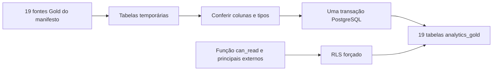

  

# Destino dos indicadores

O exportador cria tabelas homônimas aos indicadores do manifesto em `analytics_gold`. O schema base e a função `analytics_gold.can_read(text,text)` são pré-requisitos externos. Os campos são derivados por DESCRIBE e não estão fixados neste repositório.

## Objetos revisados

| Tabela | Escopo | Coluna exigida |
|---|---|---|
| `kpi_admin_cadastros` | `ADMIN` | `sem identificador de entidade` |
| `kpi_admin_modelos_status` | `ADMIN` | `sem identificador de entidade` |
| `kpi_admin_propostas_status` | `ADMIN` | `sem identificador de entidade` |
| `kpi_fornecedor_ofertas_status` | `SUPPLIER` | `supplier_id` |
| `kpi_fornecedor_estoque_modelo` | `SUPPLIER` | `supplier_id` |
| `kpi_fornecedor_ofertas_resumo` | `SUPPLIER` | `supplier_id` |
| `kpi_fornecedor_ofertas_detalhe` | `SUPPLIER` | `supplier_id` |
| `kpi_fornecedor_estoque_resumo` | `SUPPLIER` | `supplier_id` |
| `kpi_fornecedor_propostas_status` | `SUPPLIER` | `supplier_id` |
| `kpi_fornecedor_propostas_resumo` | `SUPPLIER` | `supplier_id` |
| `kpi_fornecedor_valor_aceito_produto` | `SUPPLIER` | `supplier_id` |
| `kpi_fornecedor_valor_aceito_mes` | `SUPPLIER` | `supplier_id` |
| `kpi_fornecedor_ofertas_aceitas_data` | `SUPPLIER` | `supplier_id` |
| `kpi_demandante_resumo` | `REQUESTER` | `requester_id` |
| `kpi_demandante_propostas_status` | `REQUESTER` | `requester_id` |
| `kpi_demandante_projetos_status` | `REQUESTER` | `requester_id` |
| `kpi_profissional_resumo` | `PROFESSIONAL` | `technician_id` |
| `kpi_profissional_servicos_status` | `PROFESSIONAL` | `technician_id` |
| `kpi_profissional_avaliacoes` | `PROFESSIONAL` | `technician_id` |

O exportador não cria PK, FK nem índice de busca nessas tabelas, mas cria as colunas e os tipos, compara ordem e tipos com o destino existente e exige migração explícita quando há diferença. Os nomes ainda precisam ser adaptados ao contrato do produtor.

## Escrita e leitura

A exportação obtém trava transacional, prepara staging, habilita e força RLS, recria a política `kpi_read`, limpa e repovoa cada destino na mesma transação. Falha desfaz o conjunto. Uma role leitora opcional recebe uso do schema, execução da função e SELECT, sem ser criada pelo exportador.

A RLS chama `can_read` com o escopo e o identificador da linha, e a função, os principais e os privilégios ficam provisionados no banco de analytics.

Os decimais preservam o Decimal exato e um tipo não reconhecido interrompe a carga, enquanto os timestamps com timezone sem essa informação no valor recebem UTC. O destino guarda apenas o resultado atual, sem um histórico de cargas próprio.

Fonte em [exportador](https://github.com/Solierrr/databricks-sync/blob/main/gold_synchronizer.py) e [manifesto](https://github.com/Solierrr/databricks-sync/blob/main/gold_export_manifest.json).
