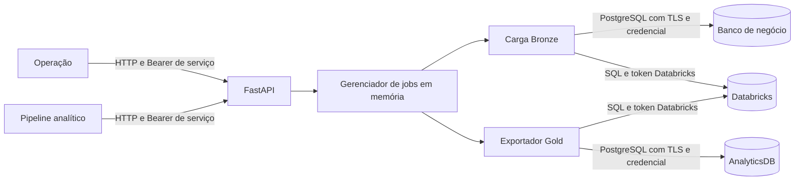

  

# Arquitetura

Serviço FastAPI com executores síncrono e em thread para Bronze e um exportador Gold. Os drivers PostgreSQL e Databricks SQL transportam dados em lotes. A API não transforma Bronze em Silver ou Gold.

## Componentes

| Caminho | Papel |
|---|---|
| `app/main.py` | Bootstrap, CORS e injeção de dependências |
| `app/routes/` | Carga, consulta de jobs e saúde |
| `app/auth.py`, `app/errors.py` | Token de serviço e ProblemDetail |
| `app/services/jobs.py` | Exclusão mútua e histórico em memória |
| `app/services/sync_service.py` | Cópia de tabelas e resumo Bronze |
| `app/infra/` | Drivers, conversão de tipos e prontidão |
| `gold_synchronizer.py` | Manifesto, staging, RLS e transação Gold |
| `gold_export_manifest.json` | Lista revisada de 19 indicadores |
| `synchronizer.py`, `api.py` | Entradas de compatibilidade para CLI e API |

## Autenticação e concorrência

O token fixo vem de `SYNC_API_TOKEN` e é comparado com `hmac.compare_digest`, sem ser um JWT de pessoa nem uma `X-Service-Key`, e a ausência de configuração responde 503 enquanto uma credencial inválida responde 401. A adoção da `X-Service-Key` por chamador está pendente.

O `JobManager` aceita uma execução por processo, compartilhada entre a Bronze e a Gold, guarda até 20 jobs e roda a Bronze assíncrona numa thread daemon. Reiniciar o processo perde o histórico e pode interromper uma execução, e várias réplicas não compartilham esse lock, enquanto a Gold acrescenta uma trava transacional no PostgreSQL entre os exportadores.

## Dados e falhas

Bronze descobre tabelas `BASE TABLE` de `public`, consulta colunas e lê por cursor nomeado em lotes. O destino usa CREATE OR REPLACE antes da inserção. Erro numa tabela permite continuar as demais e resulta em resumo de falha, sem rollback global do Databricks.

Gold descreve todas as fontes antes de escrever, verifica tipos e coluna de escopo e usa staging temporário. As 19 substituições ocorrem em uma transação PostgreSQL. Leitura das fontes Databricks não é snapshot transacional entre tabelas. Não atualizar Gold durante a exportação.

Os contratos estão em [DATABRICKS.md](../database/DATABRICKS.md) e [POSTGRES.md](../database/POSTGRES.md), e a função de autorização é provisionada antes no AnalyticsDB, de modo que o exportador aplica RLS forçado sobre a função e os principais já existentes.

## Saúde e versão

`/health` verifica só processo e informa versão de `version.txt`, atualmente `0.2.0`. `/ready` confere PostgreSQL com SELECT 1 e metadados do warehouse pela API REST, com timeouts de 2 segundos nas conexões. Acrescenta AnalyticsDB se o host está configurado. Não liga o warehouse SQL nem comprova permissão de escrita ou exportação completa.

Os logs e o progresso ficam locais, e a main analisada é a `c3c1c251`, de 2026-10-30. As fontes são o [serviço Bronze](https://github.com/Solierrr/databricks-sync/blob/main/app/services/sync_service.py), os [jobs](https://github.com/Solierrr/databricks-sync/blob/main/app/services/jobs.py), a [exportação Gold](https://github.com/Solierrr/databricks-sync/blob/main/gold_synchronizer.py) e a [prontidão](https://github.com/Solierrr/databricks-sync/blob/main/app/infra/readiness.py).