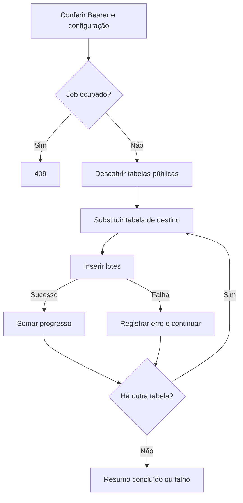

  

# Carga Bronze

A operação inicia cópia das tabelas públicas de negócio e acompanha o resultado.

## Falhas e limites

Falha por tabela não desfaz destinos anteriores. Em modo assíncrono, 202 apenas aceita o job. Reinício pode interromper a thread e perder o histórico.

Fonte em [implementação](https://github.com/Solierrr/databricks-sync/blob/main/app/services/sync_service.py). O contexto está em [cópia analítica](https://github.com/Solierrr/docs-warehouse/blob/main/docs/flows/ANALYTICS_SYNC.md).
