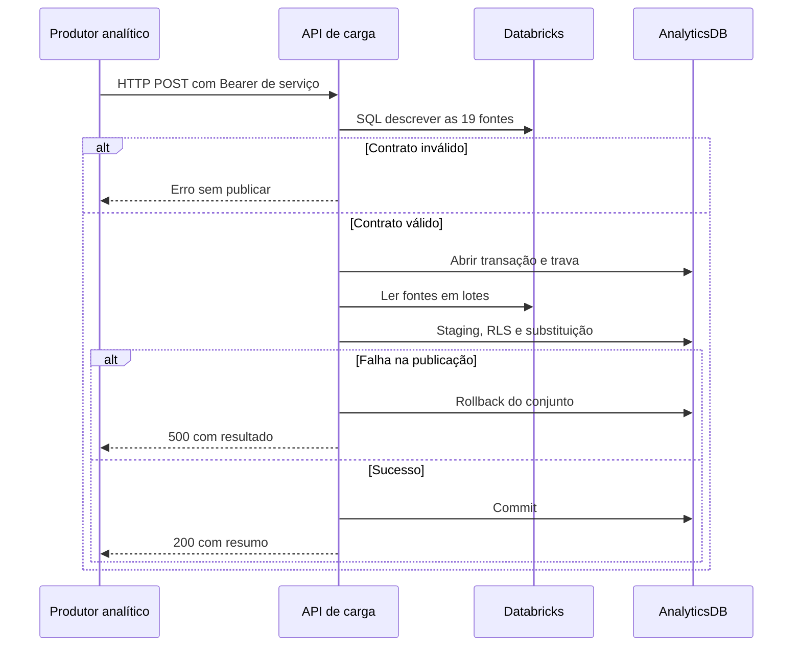

  

# Exportação Gold

O produtor solicita publicação após concluir os indicadores, desde que nomes e contratos estejam alinhados.

## Falhas e limites

Contrato atual do produtor difere do manifesto. Não basta executar o job. A transação preserva o destino PostgreSQL em falha, mas não congela a Gold de origem. <!-- PENDENTE: 1 -->

Fonte em [implementação](https://github.com/Solierrr/databricks-sync/blob/main/gold_synchronizer.py). O contexto está em [cópia analítica](https://github.com/Solierrr/docs-warehouse/blob/main/docs/flows/ANALYTICS_SYNC.md).
