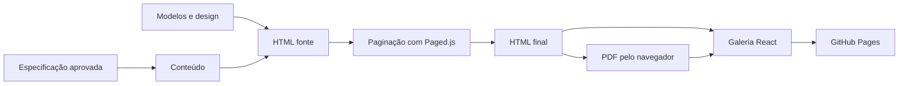

  

# Arquitetura

Os documentos usam HTML e CSS locais. A galeria React com Vite é um aplicativo separado. As regras de autoria e scripts estão em `AGENTS.md` e `functions.yaml`, enquanto `design/` define identidade e componentes.

| Pasta | Papel |
|---|---|
| `templates/` | Modelos HTML |
| `design/` | CSS, fontes, logo e componentes |
| `documents/NNN/` | Fonte, HTML paginado, PDF e checklist |
| `.work/NNN/` | Especificação, conteúdo e revisões fora do Git |
| `scripts/` | Criação, build, verificação, PDF e publicação |
| `gallery/` | Galeria e ferramentas de paginação |

O [build](https://github.com/Solierrr/docs-reports/blob/main/scripts/build.sh) chama a ferramenta Node de paginação. Gráficos usam ECharts. O PDF usa Chrome ou Edge headless. O gerador da galeria copia documentos numerados que possuam `index.html` e gera o catálogo JSON. Não há banco próprio ou API HTTP de negócio.
