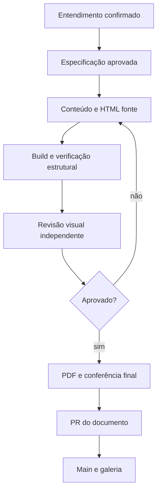

  

# Publicação de documento

O processo começa com escopo e especificação aprovados e termina com arquivos revisados numa PR.

A autoria só começa depois da aprovação do escopo, e uma falha estrutural, uma paginação incompleta ou uma revisão visual pendente impedem que o documento seja declarado pronto. Depois de três ciclos sem convergência o processo volta ao responsável, e o PDF exige um navegador disponível.