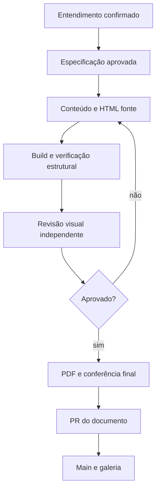

  

# Publicação de documento

O processo começa com escopo e especificação aprovados e termina com arquivos revisados numa PR.

Sem aprovação de escopo, a autoria não começa. Falha estrutural, paginação incompleta ou revisão visual pendente impede declarar o documento pronto. Após três ciclos sem convergência, o processo volta ao responsável. O PDF exige um navegador disponível.
