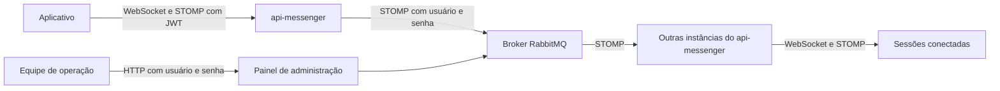

  

# Arquitetura

Uma imagem baseada em RabbitMQ 4.3.7 habilita os plugins de administração e STOMP. O `api-messenger` estabelece um relay STOMP para publicar os destinos `/topic`. O RabbitMQ distribui os eventos entre as conexões do serviço de mensagens, inclusive quando elas estão em instâncias diferentes.

## Arquivos

| Arquivo | Papel |
|---|---|
| [`Dockerfile`](https://github.com/Solierrr/infra-broker/blob/main/Dockerfile) | fixa a imagem base e copia a configuração |
| [`config/enabled_plugins`](https://github.com/Solierrr/infra-broker/blob/main/config/enabled_plugins) | liga `rabbitmq_management` e `rabbitmq_stomp` |
| [`config/rabbitmq.conf`](https://github.com/Solierrr/infra-broker/blob/main/config/rabbitmq.conf) | declara as portas AMQP, STOMP e do painel |
| [`local/docker-compose.yml`](https://github.com/Solierrr/infra-broker/blob/main/local/docker-compose.yml) | sobe o broker local com volume e health check |

## Integrações

| Com quem | Direção | Protocolo | Autenticação |
|---|---|---|---|
| `api-messenger` | chama este broker | STOMP TCP na porta 61613 | usuário e senha do RabbitMQ |
| Equipe de operação | acessa este broker | HTTP na porta 15672 | usuário e senha do RabbitMQ |

O arquivo de configuração também abre AMQP na porta 5672, mas o [README do código](https://github.com/Solierrr/infra-broker/blob/main/README.md) informa que os serviços não a usam. A autenticação da pessoa acontece antes, no `api-messenger`, durante o `CONNECT` STOMP do WebSocket. O broker não valida o JWT da pessoa.

## Dados e decisões técnicas

O ambiente local monta o volume `rabbitmq_data` em `/var/lib/rabbitmq`, para preservar os dados do processo entre reinícios do contêiner. O repositório não define schema, filas, exchanges nem políticas de retenção. A duração e a persistência efetivas das mensagens distribuídas dependem da topologia criada em execução. <!-- PENDENTE: 2 -->

O `api-messenger` liga o relay quando `RABBITMQ_RELAY_ENABLED` está ativo, ou quando `RABBITMQ_HOST` está preenchido sem uma escolha explícita. Sem relay, usa o broker em memória do Spring. A configuração do relay está em [`WebSocketConfig.java`](https://github.com/Solierrr/api-messenger/blob/main/src/main/java/com/solaria/messenger/websocket/config/WebSocketConfig.java).

## Observabilidade

O Docker Compose local usa `rabbitmq-diagnostics -q ping` a cada dez segundos. A imagem inclui o painel de administração em `15672`. Não há endpoint HTTP de liveness ou readiness implementado por este repositório.
