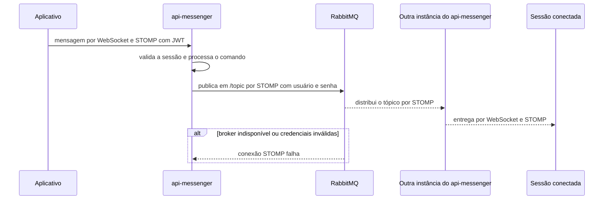

  

# Entrega de mensagem em tempo real

Quando o `api-messenger` publica um evento de conversa e o relay externo está ativo, o RabbitMQ distribui o tópico às conexões do serviço de mensagens. Cada instância entrega o evento às sessões que mantém conectadas. A autorização da pessoa e o conteúdo do evento pertencem ao `api-messenger`.

## Casos de erro

- Sem conexão com o broker, o relay não distribui novos eventos por ele. O repositório do broker não define reenvio nem fila de falhas.
- Com credenciais inválidas, o RabbitMQ recusa a conexão STOMP.
- Com o relay desabilitado, o `api-messenger` usa o broker em memória, e a entrega fica limitada à mesma instância.

O fluxo de autenticação do cliente está em [LOGIN_AND_TOKEN.md](https://github.com/Solierrr/docs-warehouse/blob/main/docs/flows/LOGIN_AND_TOKEN.md).
