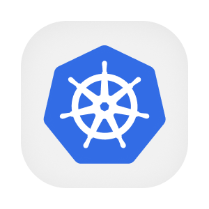

  

  
  
  
  

# Entrada e roteamento das APIs

O gateway oferece um ponto de entrada para encaminhar chamadas às APIs e aos assistentes da plataforma. No ambiente de QA, ele reúne serviços hospedados separadamente sob caminhos conhecidos. No cluster, a configuração apoia o controlador que recebe as chamadas pelos endereços de cada aplicação.

O repositório mantém a configuração declarativa do Kong e os valores usados na instalação por Helm. A instância de QA funciona sem banco e lê suas rotas ao iniciar. As regras de autenticação das operações continuam nos serviços de destino, enquanto o gateway trata encaminhamento, origens do navegador e identificação das requisições.

## Aprofunde-se no Projeto!

- [OVERVIEW.md](./docs/OVERVIEW.md), finalidade e regras de produto.
- [ARCHITECTURE.md](./docs/ARCHITECTURE.md), componentes, dados e integrações.
- [RUNNING.md](./docs/RUNNING.md), preparação e execução local.
- [API.md](./docs/API.md), autenticação e uso do contrato.
- [DEPLOY.md](./docs/DEPLOY.md), ambientes e publicação.
- [STATUS.md](./docs/STATUS.md), limites observados.
- [ROUTING.md](./flows/ROUTING.md), detalhes do fluxo ou modelo de dados.
- [CONFIG_PUBLISH.md](./flows/CONFIG_PUBLISH.md), detalhes do fluxo ou modelo de dados.
- [PENDENCIAS.md](./PENDENCIAS.md), questões para revisão.

## Contribuindo

- [CONTRIBUTING.md](https://github.com/Solierrr/.github/blob/main/.github/CONTRIBUTING.md), convenções de contribuição.
- [CODE_OF_CONDUCT.md](https://github.com/Solierrr/.github/blob/main/CODE_OF_CONDUCT.md), código de conduta.
- [SECURITY.md](https://github.com/Solierrr/.github/blob/main/SECURITY.md), relato de vulnerabilidades.
