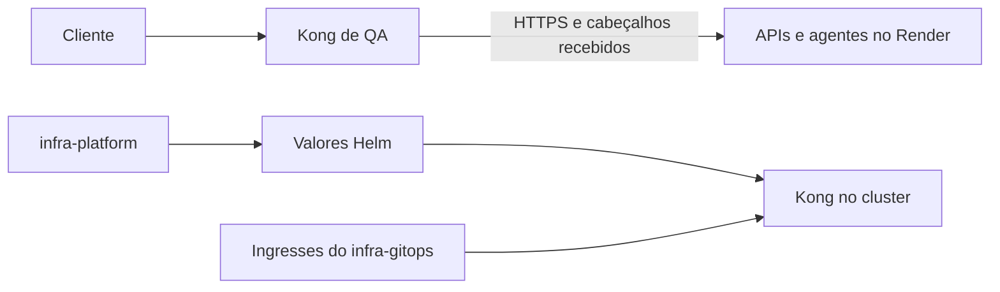

  

# Arquitetura

Há duas formas de configuração, declarativa no Render e valores Helm no cluster. A [configuração de QA](https://github.com/Solierrr/infra-gateway/blob/main/kong/kong.qa.yml) registra um serviço e uma rota por destino.

`kong/` contém rotas e plugins de QA. `helm/` contém valores base, dev e prod. O Dockerfile usa Kong 3.9.3 DB-less, Admin API desligada e logs em stdout e stderr. `docker-cmd.sh` configura listeners na porta 8000 e na porta de ambiente.

O plugin de correlação gera o `X-Request-Id`, o CORS libera as origens enumeradas sem credenciais e as rotas removem o prefixo do serviço. O `api-messenger` tem timeout de leitura e escrita de cinco minutos para a comunicação persistente, e o gateway não tem banco próprio.

A configuração Helm habilita o controlador de Ingress. A estrutura dos valores e sua compatibilidade com o chart consumido precisam de confirmação. <!-- PENDENTE: 1 -->
