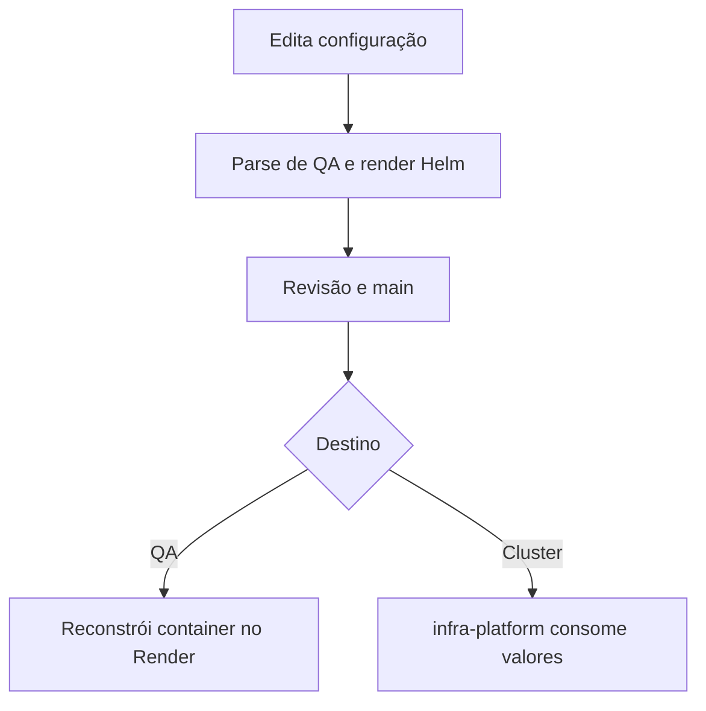

  

# Publicação de configuração

A configuração passa por revisão e validação antes de chegar ao runtime.

YAML inválido e chart incompatível impedem a entrega. O [fluxo central de deploy](https://github.com/Solierrr/docs-warehouse/blob/main/docs/flows/RELEASE_AND_DEPLOY.md) descreve os demais componentes.
