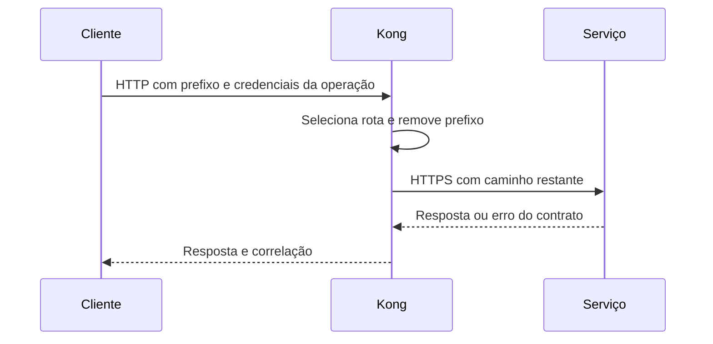

  

# Encaminhamento de chamada

Uma chamada de QA usa o prefixo do serviço para selecionar a origem.

Rota inexistente, origem indisponível e timeout podem impedir a chamada. Erros de autorização continuam sendo produzidos pelo serviço.
