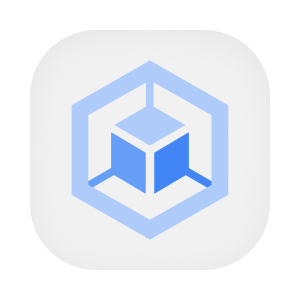

  

  
  
  

# Estado desejado do cluster

Este repositório descreve quais componentes devem funcionar no ambiente de produção e como eles são executados. A equipe revisa alterações antes da publicação, e o histórico permite identificar a configuração desejada em cada momento. Ele reúne aplicações de negócio, agentes, mensageria, observabilidade e o banco usado nas recomendações.

O Argo CD acompanha os arquivos versionados e aplica as mudanças no Kubernetes. Uma aplicação raiz descobre as aplicações filhas, que apontam para os recursos de cada serviço. As credenciais são referenciadas por segredos do cluster. O repositório também oferece uma forma de conferir a sincronização em um cluster local.

## Aprofunde-se no Projeto!

- [OVERVIEW.md](./docs/OVERVIEW.md), finalidade e regras de produto.
- [ARCHITECTURE.md](./docs/ARCHITECTURE.md), componentes, dados e integrações.
- [RUNNING.md](./docs/RUNNING.md), preparação e execução local.
- [DEPLOY.md](./docs/DEPLOY.md), ambientes e publicação.
- [STATUS.md](./docs/STATUS.md), limites observados.
- [HOW_IT_WORKS.md](./docs/HOW_IT_WORKS.md), detalhes do fluxo ou modelo de dados.
- [Fluxos](./flows/), etapas e casos de erro do repositório.
- [PENDENCIAS.md](./PENDENCIAS.md), questões para revisão.

## Contribuindo

- [CONTRIBUTING.md](https://github.com/Solierrr/.github/blob/main/.github/CONTRIBUTING.md), convenções de contribuição.
- [CODE_OF_CONDUCT.md](https://github.com/Solierrr/.github/blob/main/CODE_OF_CONDUCT.md), código de conduta.
- [SECURITY.md](https://github.com/Solierrr/.github/blob/main/SECURITY.md), relato de vulnerabilidades.
