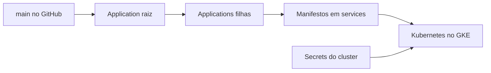

  

# Arquitetura

O padrão app-of-apps começa em [bootstrap/root-app.yaml](https://github.com/Solierrr/infra-gitops/blob/main/bootstrap/root-app.yaml). A raiz observa `apps/` recursivamente na main. Cada `Application` aponta para `services/<componente>`.

A raiz e as aplicações usam sincronização automática com `prune` e `selfHeal`. O destino das filhas é normalmente o namespace `default`, enquanto as Applications ficam em `argocd`.

| Pasta | Papel |
|---|---|
| `bootstrap/` | Application raiz |
| `apps/` | Applications de APIs, agentes, web, infraestrutura e banco |
| `services/` | Deployments, Services, Ingresses e recursos persistentes |
| `scripts/` | Cluster local e operações auxiliares |

O Argo CD lê o Git por HTTPS. O Kubernetes obtém as imagens dos registros declarados e injeta configuração por `secretRef`. Aplicações e contratos entre serviços ficam sob responsabilidade dos respectivos repositórios. O [mapa central](https://github.com/Solierrr/docs-warehouse/blob/main/docs/flows/INTEGRATIONS.md) descreve essas integrações.

Os manifestos incluem limites de recursos e probes por componente. Parte dos serviços ainda usa probes TCP e imagens com `latest`, conforme [STATUS.md](./STATUS.md).
