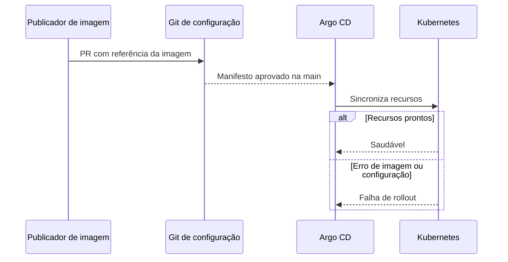

  

# Promoção de imagem

A versão publicada de um serviço é referenciada no manifesto para chegar ao cluster. O processo entre repositórios está em [RELEASE_AND_DEPLOY.md](https://github.com/Solierrr/docs-warehouse/blob/main/docs/flows/RELEASE_AND_DEPLOY.md).

Imagem inexistente, secret ausente e probes em falha impedem a disponibilidade. O manifesto precisa referenciar uma tag existente e compatível.
