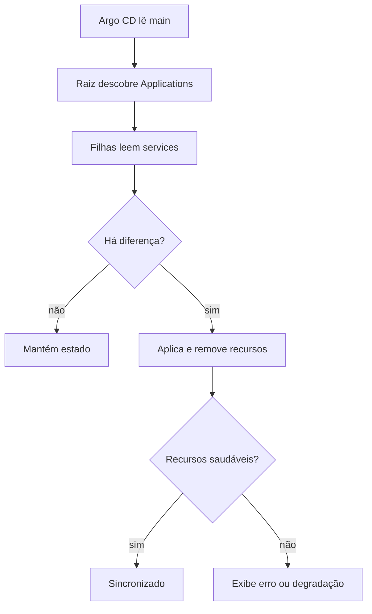

  

# Sincronização

A sincronização faz o estado do cluster convergir para os manifestos da main.

Falha ao ler Git, manifesto inválido e permissões insuficientes impedem sincronizar. `prune` permite remover recursos e `selfHeal` permite reverter alterações manuais no cluster.
