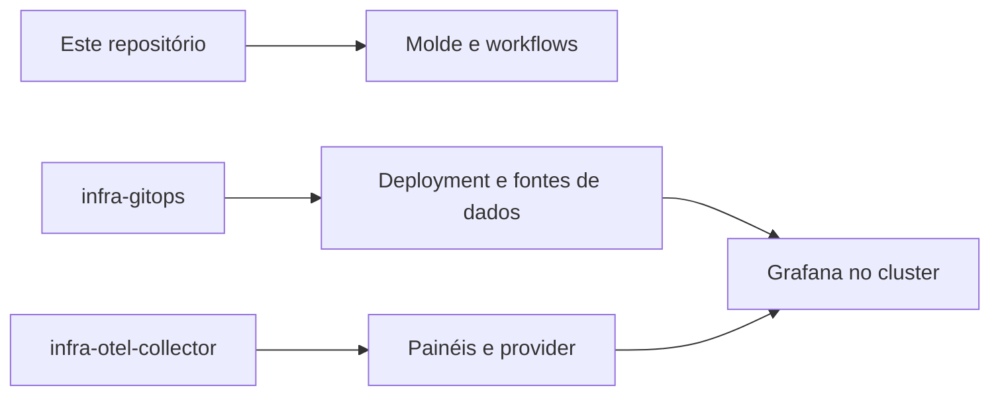

  

# Arquitetura

A main contém README de template, Dockerfile apenas com comentários, Makefile sem comandos específicos e coleção Bruno de exemplo. O entrypoint genérico pode iniciar um comando com configuração do Infisical, mas nenhum comando de aplicação foi definido no Dockerfile.

A [Application de Grafana](https://github.com/Solierrr/infra-gitops/blob/main/apps/infra/grafana.yaml) usa duas fontes. O GitOps fornece Deployment, Service, Ingress, volume e fontes de dados. O coletor fornece os ConfigMaps dos painéis.

A configuração externa usa Grafana 13.2.5, volume persistente e consulta a Prometheus, Loki e Tempo do backend de observabilidade. O acesso externo usa JWT do Cloudflare Access e papéis configurados no Secret. Esses recursos não são construídos a partir deste Dockerfile.
