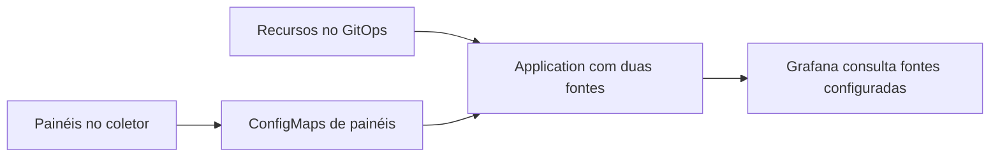

  

# Configuração dos painéis existentes

A configuração operacional existente usa arquivos de outros repositórios. O fluxo abaixo localiza seus responsáveis e não pressupõe uma implementação neste molde.

ConfigMap ausente, credencial inválida e backend indisponível impedem visualizar dados. O contexto da telemetria está no [mapa de integrações](https://github.com/Solierrr/docs-warehouse/blob/main/docs/flows/INTEGRATIONS.md).
