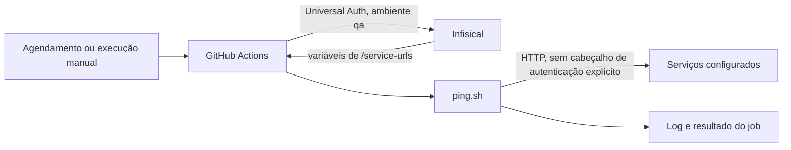

  

# Arquitetura

Um workflow do GitHub Actions carrega variáveis do Infisical e executa `ping.sh` em um runner Ubuntu. O script seleciona nomes terminados em `_URL`, consulta cada valor com `curl` e encerra com código diferente de zero se não houver destinos ou se algum destino falhar.

## Arquivos

| Caminho | Papel |
|---|---|
| [`ping.sh`](https://github.com/Solierrr/infra-keepalive/blob/main/ping.sh) | Descobre as variáveis, consulta os destinos e contabiliza falhas. |
| [`.github/workflows/keepalive.yml`](https://github.com/Solierrr/infra-keepalive/blob/main/.github/workflows/keepalive.yml) | Agenda o job e obtém a configuração de QA. |
| [`.github/workflows/ci.yml`](https://github.com/Solierrr/infra-keepalive/blob/main/.github/workflows/ci.yml) | Verifica a sintaxe Bash. |
| [`.github/workflows/quality.yml`](https://github.com/Solierrr/infra-keepalive/blob/main/.github/workflows/quality.yml) | Executa ShellCheck. |
| [`Makefile`](https://github.com/Solierrr/infra-keepalive/blob/main/Makefile) | Expõe comandos locais e exportação de configuração. |

## Integrações

| Com quem | Direção | Protocolo | Autenticação |
|---|---|---|---|
| GitHub Actions | Inicia o script por agendamento ou manualmente | Job em runner Ubuntu | Permissões e configuração do repositório no GitHub |
| Infisical | O workflow lê `/service-urls` em QA | Action de segredos | Universal Auth com credenciais armazenadas no GitHub |
| Serviços configurados | O script consulta cada endereço | HTTP ou HTTPS pelo `curl` | Nenhum cabeçalho de autenticação é acrescentado pelo script |

O ciclo está em [PING_CYCLE.md](../flows/PING_CYCLE.md). O contexto de publicação dos serviços consultados está no [fluxo de release e deploy](https://github.com/Solierrr/docs-warehouse/blob/main/docs/flows/RELEASE_AND_DEPLOY.md).

## Dados e decisões

Não há banco próprio. Os destinos vêm do ambiente e são ordenados pelo nome da variável. Isso permite alterar a lista no Infisical sem editar o script. As consultas são sequenciais, com até três tentativas por destino, limite de dez segundos por tentativa e pausa de cinco segundos após cada falha, inclusive a última. O corpo da resposta é descartado e o script usa o resultado do `curl --fail` para contabilizar sucesso ou falha.

## Observabilidade e health

O script imprime o nome e o endereço completo de cada destino e um total de respostas. Ele não expõe endpoint de health nem versão própria. A URL é usada exatamente como configurada, sem acrescentar `/health`. Portanto o caminho efetivamente consultado depende da configuração. <!-- PENDENTE: 2 --> Evite incluir credenciais ou dados sensíveis nos endereços, pois eles aparecem no log.
