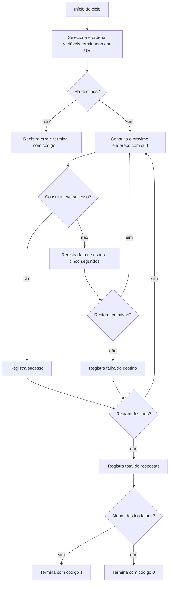

  

# Ciclo de consultas

O ciclo começa pelo agendamento, por disparo manual ou pela execução local. Ele consulta em sequência cada endereço disponível no ambiente e termina com um resumo e o resultado do processo.

Cada tentativa tem limite de dez segundos e cada destino recebe até três tentativas. O endereço é usado como foi configurado. O [processo de QA](https://github.com/Solierrr/docs-warehouse/blob/main/readme/deploy/QA_RENDER.md) descreve os serviços hospedados no Render e o [fluxo de release e deploy](https://github.com/Solierrr/docs-warehouse/blob/main/docs/flows/RELEASE_AND_DEPLOY.md) descreve sua publicação.

## Falhas

- Sem variáveis com sufixo `_URL`, o script registra erro e termina sem consultas.
- Uma falha de conexão, timeout ou resposta HTTP de erro provoca nova tentativa. Após três falhas, o script registra o destino e continua com os demais.
- Uma falha na obtenção da configuração pelo workflow impede a etapa de consultas.
