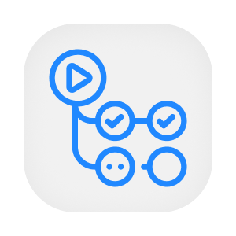
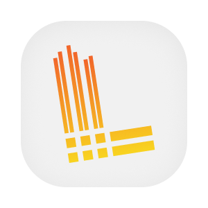
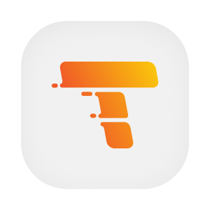

  

  
  
  
  
  

# Painéis e alertas operacionais

Este repositório guarda os painéis e as regras de alerta que a equipe usa para acompanhar a saúde da plataforma. Os painéis mostram, em um só lugar, quanto cada serviço está sendo usado, quantos erros aparecem e quanto tempo as respostas levam, e as regras de alerta avisam a equipe quando um serviço para de responder, erra demais ou fica lento.

Os painéis e os alertas são arquivos de provisionamento do Grafana, que consulta as métricas no Prometheus, os registros no Loki e os rastros no Tempo. São quatro painéis, um geral, um para os serviços Java, um para os serviços Python e um de análise de erros, e quinze regras de alerta com prioridade, enviadas por webhook ao serviço de e-mail. A instância do Grafana é publicada pelo repositório de GitOps, e a coleta da telemetria fica no coletor.

## Aprofunde-se no Projeto!

- [OVERVIEW.md](./docs/OVERVIEW.md), finalidade e regras de produto.
- [ARCHITECTURE.md](./docs/ARCHITECTURE.md), componentes, dados e integrações.
- [RUNNING.md](./docs/RUNNING.md), como ver os painéis localmente.
- [DEPLOY.md](./docs/DEPLOY.md), ambientes e publicação.
- [STATUS.md](./docs/STATUS.md), limites observados.
- [Fluxos](./flows/), a configuração de painéis e alertas.

## Contribuindo

- [CONTRIBUTING.md](https://github.com/Solierrr/.github/blob/main/.github/CONTRIBUTING.md), convenções de contribuição.
- [CODE_OF_CONDUCT.md](https://github.com/Solierrr/.github/blob/main/CODE_OF_CONDUCT.md), código de conduta.
- [SECURITY.md](https://github.com/Solierrr/.github/blob/main/SECURITY.md), relato de vulnerabilidades.
