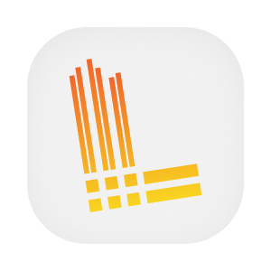

  

  
  
  
  
  

# Configuração de visualização operacional

Este repositório está destinado à organização da visualização operacional da plataforma, mas sua main ainda contém a estrutura inicial de um serviço. A configuração que permite à equipe consultar métricas, registros e rastros está hoje mantida em outros repositórios de infraestrutura. Essa divisão precisa ser considerada ao localizar arquivos e planejar mudanças.

A instância Grafana é descrita pelo GitOps, enquanto painéis e configuração de sua descoberta vêm do coletor de telemetria. Este repositório conserva arquivos de preparação, integração de configuração e workflows, sem uma aplicação ou imagem executável implementada. A definição do papel definitivo desse conjunto ainda depende do responsável.

## Aprofunde-se no Projeto!

- [OVERVIEW.md](./docs/OVERVIEW.md), finalidade e regras de produto.
- [ARCHITECTURE.md](./docs/ARCHITECTURE.md), componentes, dados e integrações.
- [RUNNING.md](./docs/RUNNING.md), preparação e execução local.
- [DEPLOY.md](./docs/DEPLOY.md), ambientes e publicação.
- [STATUS.md](./docs/STATUS.md), limites observados.
- [Fluxos](./flows/), etapas e casos de erro do repositório.
- [PENDENCIAS.md](./PENDENCIAS.md), questões para revisão.

## Contribuindo

- [CONTRIBUTING.md](https://github.com/Solierrr/.github/blob/main/.github/CONTRIBUTING.md), convenções de contribuição.
- [CODE_OF_CONDUCT.md](https://github.com/Solierrr/.github/blob/main/CODE_OF_CONDUCT.md), código de conduta.
- [SECURITY.md](https://github.com/Solierrr/.github/blob/main/SECURITY.md), relato de vulnerabilidades.
