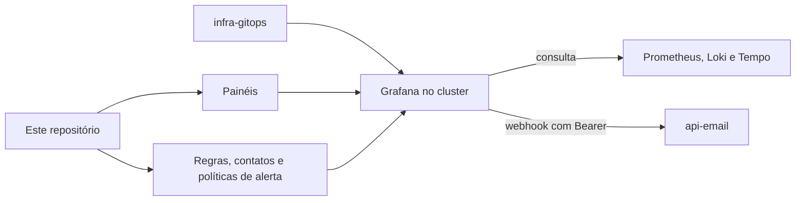

  

# Arquitetura

O repositório contém arquivos de provisionamento do Grafana, sem aplicação própria. Os painéis ficam em `dashboards/` e os alertas em `alerting/`.

| Caminho | Conteúdo |
|---|---|
| `dashboards/` | quatro painéis em JSON, saúde geral, serviço Java, serviço Python e análise de erros |
| `alerting/rules.yaml` | quinze regras avaliadas a cada minuto sobre o Prometheus, de A01 a A15 |
| `alerting/contact-points.yaml` | três pontos de contato por webhook, para as rotas de Jira, e-mail e WhatsApp do `api-email` |
| `alerting/notification-policies.yaml` | agrupamento, espera, repetição e rotas por prioridade |

A [Application de Grafana](https://github.com/Solierrr/infra-gitops/blob/main/apps/infra/grafana.yaml) publica a instância, com o Deployment, o Service, o Ingress, o volume e as fontes de dados, e consulta o Prometheus, o Loki e o Tempo do backend de observabilidade. O acesso externo usa o JWT do Cloudflare Access e os papéis configurados no Secret.

Os pontos de contato enviam ao `api-email` com Bearer, lido da variável `API_EMAIL_KEY` no ambiente do Grafana. O roteamento atual dos incidentes para o Jira, o e-mail e o Telegram é feito pelo `worker-alerts`, declarado no [módulo de alertas](https://github.com/Solierrr/infra-platform/blob/main/modules/alerts/grafana.tf) do `infra-platform`, e os contatos deste repositório apontam para as rotas anteriores do `api-email`.

O repositório ainda conserva o Dockerfile e o entrypoint genérico do molde, sem uma imagem de aplicação.
