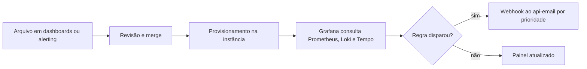

  

# Configuração dos painéis e alertas

Acontece quando a equipe cria ou ajusta um painel ou uma regra de alerta. O resultado é o Grafana mostrando o painel atualizado e avaliando a regra a cada minuto.

## Casos de erro

- Uma fonte de dados sem o uid `prometheus` deixa as regras sem avaliação.
- Sem a variável `API_EMAIL_KEY`, os webhooks são recusados pelo destino.
- Um backend de telemetria indisponível dispara o alerta de serviço sem dados.

O contexto da telemetria está no [mapa de integrações](https://github.com/Solierrr/docs-warehouse/blob/main/docs/flows/INTEGRATIONS.md).
