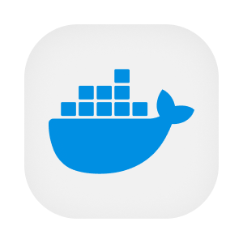

  

  
  
  

# Coleta central de telemetria

O coletor reúne os registros, métricas e rastros de execução dos serviços para apoiar o diagnóstico da plataforma. Ele aplica um tratamento comum antes de enviar os dados ao ambiente de observabilidade. A equipe consegue relacionar falhas e lentidão de uma operação sem configurar um destino diferente em cada aplicação.

Os serviços enviam telemetria por OTLP ao OpenTelemetry Collector. A configuração controla memória, atributos, amostragem e envio em lote. Em produção, o destino configurado é o Grafana Cloud. No desenvolvimento, uma composição local oferece coleta e visualização com painéis versionados no mesmo repositório.

## Aprofunde-se no Projeto!

- [OVERVIEW.md](./docs/OVERVIEW.md), finalidade e regras de produto.
- [ARCHITECTURE.md](./docs/ARCHITECTURE.md), componentes, dados e integrações.
- [RUNNING.md](./docs/RUNNING.md), preparação e execução local.
- [API.md](./docs/API.md), autenticação e uso do contrato.
- [DEPLOY.md](./docs/DEPLOY.md), ambientes e publicação.
- [STATUS.md](./docs/STATUS.md), limites observados.
- [Fluxos](./flows/), etapas e casos de erro do repositório.
- [PENDENCIAS.md](./PENDENCIAS.md), questões para revisão.

## Contribuindo

- [CONTRIBUTING.md](https://github.com/Solierrr/.github/blob/main/.github/CONTRIBUTING.md), convenções de contribuição.
- [CODE_OF_CONDUCT.md](https://github.com/Solierrr/.github/blob/main/CODE_OF_CONDUCT.md), código de conduta.
- [SECURITY.md](https://github.com/Solierrr/.github/blob/main/SECURITY.md), relato de vulnerabilidades.
