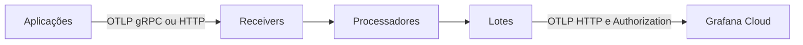

  

# Arquitetura

O Collector Contrib 0.115.1 recebe OTLP e executa pipelines separados de traces, métricas e logs. A [configuração](https://github.com/Solierrr/infra-otel-collector/blob/main/k8s/otel-collector-config.yaml) vira ConfigMap via Kustomize.

`k8s/` contém a base. `overlays/` ajusta ambiente e amostragem. `local/` oferece Compose e override sem detector GCP. `grafana/` mantém painéis e seu provider.

O limite de memória antecede o processamento. Os pipelines enriquecem atributos e removem cabeçalhos selecionados. Traces têm SQL esvaziado e tail sampling. Métricas removem rótulos de alta cardinalidade. Logs usam a remoção de cabeçalhos, sem aplicar o transform SQL de traces.

O tail sampling espera dez segundos, mantém erros e traces acima de dois segundos e aplica amostragem probabilística ao restante. O Deployment usa uma réplica para concentrar os spans. O envio usa lotes com timeout de cinco segundos. O health da extensão usa a porta 13133.
