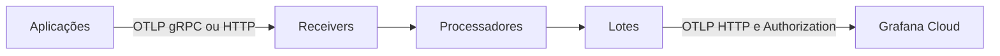

  

# Arquitetura

O Collector Contrib 0.115.1 recebe OTLP e executa pipelines separados de traces, métricas e logs. A [configuração](https://github.com/Solierrr/infra-otel-collector/blob/main/k8s/otel-collector-config.yaml) vira ConfigMap via Kustomize.

A pasta `k8s/` contém a base, a `overlays/` ajusta o ambiente e a amostragem, a `local/` oferece o Compose e um override sem o detector GCP e a `grafana/` mantém os painéis e o seu provider.

O limite de memória vem antes do processamento, e os pipelines enriquecem os atributos e removem os cabeçalhos selecionados. Os traces têm o SQL esvaziado e passam por tail sampling, as métricas perdem os rótulos de alta cardinalidade e os logs usam a remoção de cabeçalhos, sem o transform SQL aplicado aos traces.

O tail sampling espera dez segundos, mantém erros e traces acima de dois segundos e aplica amostragem probabilística ao restante. O Deployment usa uma réplica para concentrar os spans. O envio usa lotes com timeout de cinco segundos. O health da extensão usa a porta 13133.
