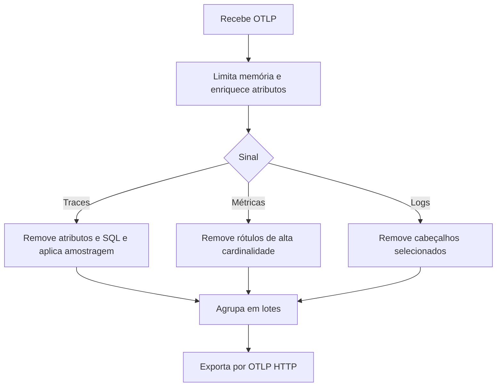

  

# Tratamento da telemetria

Cada sinal passa pelo pipeline correspondente antes da exportação.

Credencial ausente, destino inacessível ou configuração inválida afeta exportação. O health do processo não comprova que todas as aplicações estão enviando ou que os dados chegaram ao backend.
