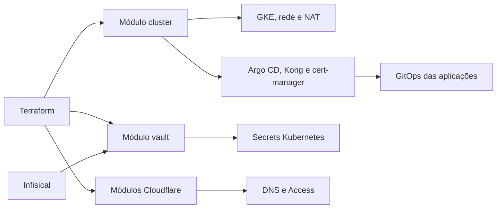

  

# Arquitetura

A composição Terraform separa cluster, cofre e Cloudflare. A fonte está em [main.tf](https://github.com/Solierrr/infra-platform/blob/main/main.tf).

`modules/cluster/` cria rede, GKE, pool, endereços, NAT e releases Helm. `modules/vault/` lê Infisical de produção e monta Secrets. `modules/cloudflare/` mantém DNS, cache e Access. `modules/cloudflare-token/` gere o token operacional. `scripts/` contém utilitários PowerShell.

O cluster usa um pool separado e o control plane limita acesso por faixa autorizada. O Kong usa endereço reservado e limita origens conforme faixas de borda. Seus valores base e dev são lidos por HTTP do repositório do gateway, com ajustes explícitos de LoadBalancer e TLS.

O bootstrap instala Argo CD e controladores, mas as aplicações são sincronizadas pela raiz do `infra-gitops`. Os providers usam credenciais autorizadas do Google Cloud e Infisical. Blocos `moved` preservam endereços de state após a divisão em módulos. Não há banco de negócio próprio.
