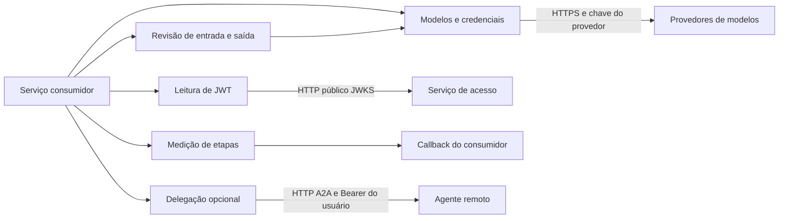

  

# Arquitetura

Biblioteca Python 3.14 ou superior, com import `ai_lib` e distribuição definida pelo `pyproject.toml`. LangChain fornece a interface dos modelos, LangGraph recebe os nós de revisão e o extra `a2a` acrescenta SDK de delegação e FastAPI.

## Módulos

| Pasta em `src/ai_lib/` | Papel |
|---|---|
| `registry/` | Tipos de lease e erros. Nome histórico, sem registro remoto |
| `llm/` | Chat, embeddings, credenciais, falhas e preços |
| `guardrails/` | Anonimização, padrões de injeção, prompts, parsers e nós de revisão |
| `security/` | RS256 por JWKS e extração de `sub` |
| `observability/` | Callback de tokens, latência, ferramentas e custo |
| `a2a/` | Agent Card, rotas, executor e cliente opcional |

## Integrações

| Relação | Protocolo | Autenticação |
|---|---|---|
| Consumidor carrega a biblioteca | Import Python | Não se aplica |
| Chat e embeddings chamam provedores | HTTPS pelos adaptadores | Chave do ambiente |
| Identidade consulta chaves públicas | JWKS por HTTP | Assinatura RS256 e issuer esperado |
| Agente delega ao remoto | A2A por HTTP | Bearer do usuário quando fornecido |
| Medição envia etapas | Callback assíncrono | Definida pelo consumidor |

## Decisões e dados

O cliente padrão de chaves é criado uma vez por processo. Rodízio, chaves inválidas e cooldown ficam em memória protegida por lock. Não há banco próprio ou coordenação entre réplicas. Reconstruir o cliente ou reiniciar o processo permite carregar alterações do ambiente.

`get_chat_model_with_fallback` monta uma dupla pelos argumentos. `get_chat_model_from_env` usa a ordem dos provedores com chave. Embeddings usam o adaptador Gemini, sem herdar a cadeia de chat.

`decode_user_id` verifica RS256 e issuer e devolve `None` em falha. O cliente JWKS é reutilizado por URL. A função não verifica cargo ou participação em recurso. `mount_a2a` usa `InMemoryTaskStore` e não adiciona autenticação por si só. O consumidor protege as rotas e armazena a conversa.

## Observabilidade e versão

`StepTracker` envia documentos ao callback recebido. Falha no envio gera aviso sem interromper o fluxo. O custo é estimado pela tabela local e pelos tokens reportados. Não há endpoint de health próprio.

A main analisada é `a3e62c9b`, de 2026-10-30, com versão declarada `0.2.1`. As fontes são [configuração do pacote](https://github.com/Solierrr/lib-ai/blob/main/pyproject.toml), [chat](https://github.com/Solierrr/lib-ai/blob/main/src/ai_lib/llm/chat.py), [credenciais](https://github.com/Solierrr/lib-ai/blob/main/src/ai_lib/llm/env_keys.py), [JWT](https://github.com/Solierrr/lib-ai/blob/main/src/ai_lib/security/jwt.py) e [medição](https://github.com/Solierrr/lib-ai/blob/main/src/ai_lib/observability/step_tracker.py).
