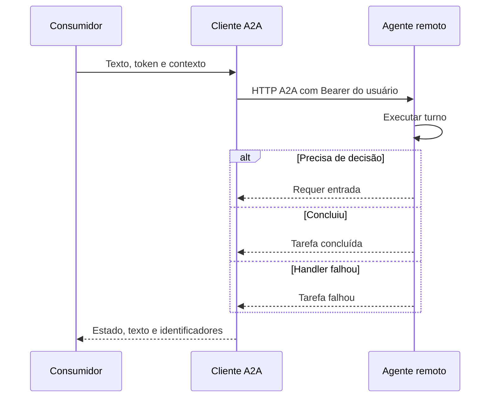

  

# Delegação de tarefa

O cliente encaminha texto, identidade e contexto a um agente remoto.

## Falhas e limites

Transporte, timeout ou resposta sem tarefa gera DelegationError. O consumidor protege as rotas. O fluxo integrado está em [conversa com assistentes](https://github.com/Solierrr/docs-warehouse/blob/main/docs/flows/ASSISTANT_CHAT.md).

Fonte em [implementação](https://github.com/Solierrr/lib-ai/blob/main/src/ai_lib/a2a/executor.py).
