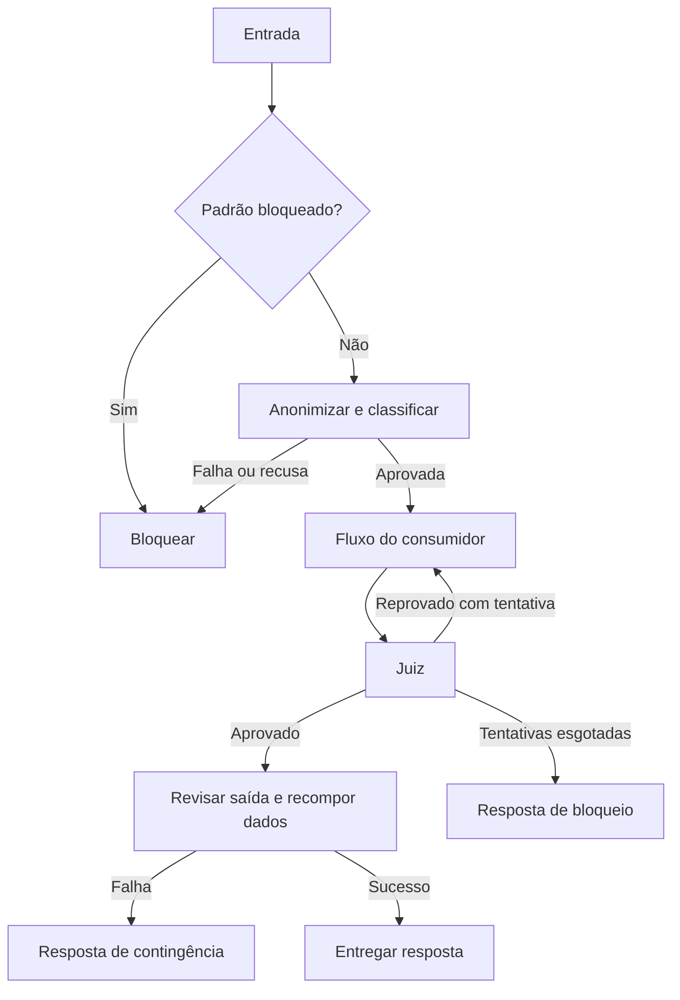

  

# Revisão de mensagens

O consumidor conecta os nós ao grafo para revisar entrada e saída.

## Falhas e limites

Uma falha na entrada bloqueia a mensagem e uma falha do juiz conta como reprovação, mas criar os nós não executa o fluxo inteiro, porque as transições pertencem ao consumidor.

Fonte em [implementação](https://github.com/Solierrr/lib-ai/blob/main/src/ai_lib/guardrails/nodes.py).
