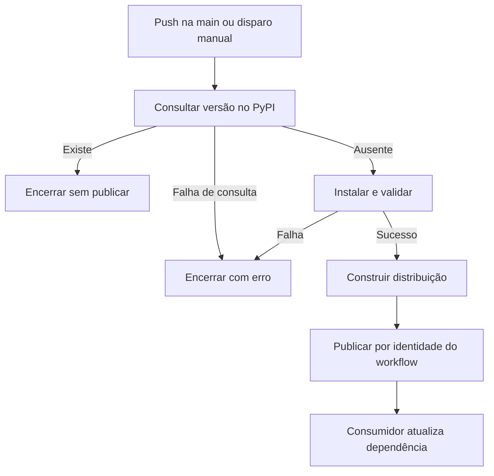

  

# Publicação do pacote

O workflow consulta a versão antes de construir e publicar.

## Falhas e limites

Falha de consulta não equivale a versão ausente. Falhas de teste, lint e build impedem a publicação. Trusted Publishing depende do ambiente configurado. O processo integrado está em [release e deploy](https://github.com/Solierrr/docs-warehouse/blob/main/docs/flows/RELEASE_AND_DEPLOY.md).

Fonte em [implementação](https://github.com/Solierrr/lib-ai/blob/main/.github/workflows/publish.yml).
