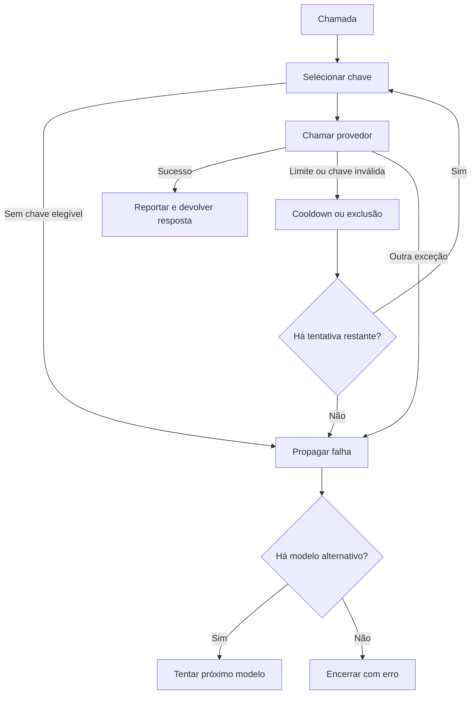

  

# Seleção de credencial

Uma chamada escolhe uma chave elegível e pode seguir para outra chave ou provedor quando configurado.

## Falhas e limites

Sem chave a seleção falha imediatamente, e o cooldown usa o Retry-After numérico ou 60 segundos por padrão. Uma chave inválida fica excluída durante toda a vida do cliente, e a classificação examina até cinco exceções encadeadas.

Fonte em [implementação](https://github.com/Solierrr/lib-ai/blob/main/src/ai_lib/llm/leasing.py).
