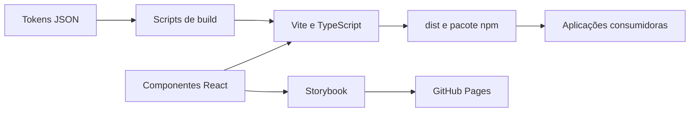

  

# Arquitetura

A biblioteca usa TypeScript, React e Vite em modo library, com módulos ESM e declarações de tipos. O [manifesto](https://github.com/Solierrr/lib-web/blob/main/package.json) define entradas para componentes, e-mail, tokens e observabilidade.

`src/components/` contém o kit visual. `src/email/` atende renderização de e-mail no servidor. `src/tokens/` é a fonte do tema. `src/observability/` contém logger e exportação. `scripts/` gera tokens e branding e copia assets.

React e outras bibliotecas de UI são peer dependencies. O bundle externaliza os runtimes para evitar cópias no consumidor. Não há banco próprio. As entradas `/email` e `/observability` evitam carregar a raiz de componentes do navegador.

O consumidor fornece Router e contexto de tradução quando necessários. `uiTranslations` fornece textos sem iniciar a internacionalização global. Os detalhes estão em [API.md](./API.md), [EMAIL.md](./EMAIL.md) e [OBSERVABILITY.md](./OBSERVABILITY.md).
