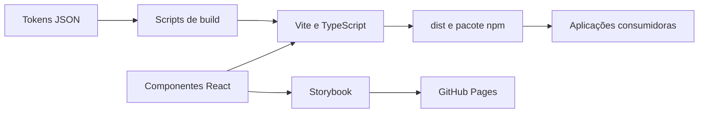

  

# Arquitetura

A biblioteca usa TypeScript, React e Vite em modo library, com módulos ESM e declarações de tipos. O [manifesto](https://github.com/Solierrr/lib-web/blob/main/package.json) define entradas para componentes, e-mail, tokens e observabilidade.

A pasta `src/components/` contém o kit visual, a `src/email/` atende a renderização de e-mail no servidor, a `src/tokens/` é a fonte do tema e a `src/observability/` reúne o logger e a exportação, enquanto a `scripts/` gera os tokens e o branding e copia os assets.

O React e as outras bibliotecas de UI são peer dependencies, e o bundle externaliza esses runtimes para evitar cópias no consumidor. A biblioteca não tem banco próprio, e as entradas `/email` e `/observability` evitam carregar a raiz de componentes do navegador.

O consumidor fornece o Router e o contexto de tradução quando necessários, e o `uiTranslations` entrega os textos sem iniciar a internacionalização global. Os detalhes estão em [API.md](./API.md), [EMAIL.md](./EMAIL.md) e [OBSERVABILITY.md](./OBSERVABILITY.md).