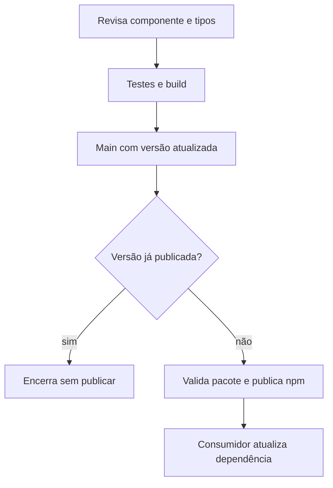

  

# Publicação de versão

A mudança de componente chega ao consumidor por uma versão do pacote.

Falha de consulta ao registro, validação ou credencial impede publicar. O fluxo comum está em [PACKAGE_RELEASE.md](https://github.com/Solierrr/docs-warehouse/blob/main/readme/deploy/PACKAGE_RELEASE.md).
