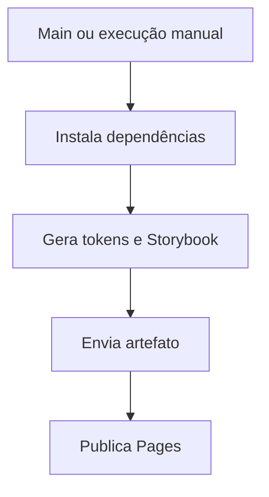

  

# Publicação do catálogo

Uma alteração da main ou um disparo manual inicia o build do catálogo.

Falhas de dependência, histórias ou permissão de Pages impedem a publicação. O catálogo exibe componentes e não substitui a integração na aplicação.
