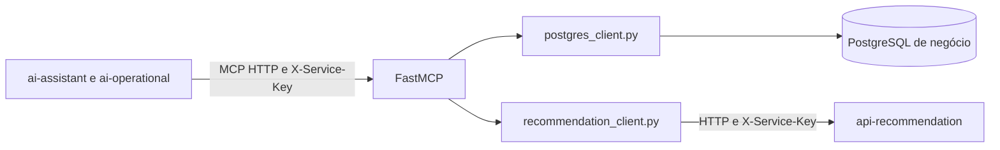

  

# Arquitetura

O [server.py](https://github.com/Solierrr/mcp-database/blob/main/server.py) registra ferramentas no FastMCP e as serve por Starlette e Uvicorn. Não é uma API REST FastAPI.

| Arquivo | Papel |
|---|---|
| `server.py` | Ferramentas, middleware e health |
| `settings.py` | Variáveis e validação de chaves |
| `postgres_client.py` | Pool síncrono de até dez conexões |
| `recommendation_client.py` | HTTP de feeds e conversão para os agentes |

A chave recebida identifica `ai-assistant` ou `ai-operational`. A chave própria `SERVICE_KEY` identifica este servidor na chamada ao motor de recomendações. A comparação usa tempo constante. A chave legada continua aceita apenas quando configurada e sem uma chave nova no cabeçalho.

Consultas SQL são parametrizadas. O código não impõe sessão SQL read-only, portanto o privilégio do login é parte da configuração de acesso. O readiness abre conexão separada do pool e executa `SELECT 1`. A versão vem de `version.txt`. Não há schema próprio. O fluxo completo está em [ASSISTANT_CHAT.md](https://github.com/Solierrr/docs-warehouse/blob/main/docs/flows/ASSISTANT_CHAT.md).
