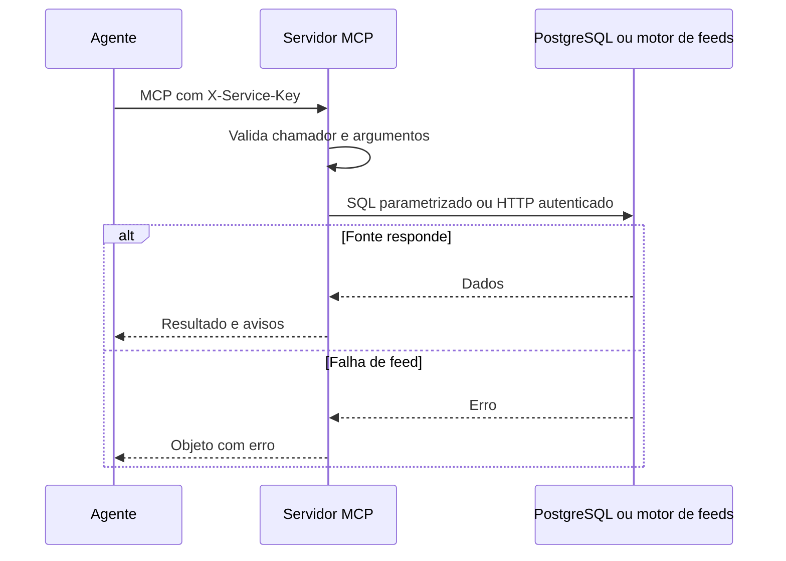

  

# Chamada de ferramenta

O agente descobre o catálogo e executa uma ferramenta de leitura. O [fluxo de recomendações](https://github.com/Solierrr/docs-warehouse/blob/main/docs/flows/RECOMMENDATION_FEED.md) descreve a origem dos rankings.

Chave inválida impede a chamada. Problemas de schema ou conexão afetam consultas diretas. A ausência de ranking não deve ser substituída por ofertas inventadas pelo agente.
