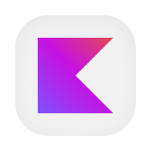

  

  
  
  
  

# Aplicativo de projetos e conversas

O aplicativo Android reúne projetos, perfis e conversas para as pessoas que trabalham na plataforma. A pessoa entra pelo navegador, retorna ao aplicativo e consulta os dados permitidos pela sua conta. Nas conversas, pode ler o histórico já guardado no aparelho e preparar novas mensagens sem conexão. As mensagens pendentes são enviadas quando há rede e o aplicativo está em execução.

A interface usa Kotlin e Jetpack Compose. As chamadas aos serviços de acesso, cadastro e mensagens usam JWT. Um banco local mantém o histórico humano, a lista de conversas e os envios pendentes, enquanto eventos em tempo real atualizam a tela. Há variantes para QA e produção. Algumas áreas ainda usam conteúdo local de exemplo, com os limites descritos na documentação.

## Aprofunde-se no Projeto!

- [OVERVIEW.md](./docs/OVERVIEW.md), capacidades e regras para a pessoa.
- [ARCHITECTURE.md](./docs/ARCHITECTURE.md), camadas, integrações e sessão.
- [RUNNING.md](./docs/RUNNING.md), ambiente Android e testes.
- [API.md](./docs/API.md), callback e protocolos consumidos.
- [DEPLOY.md](./docs/DEPLOY.md), variantes e distribuição.
- [STATUS.md](./docs/STATUS.md), integrações e limitações atuais.
- [Fluxos](./flows/), login, navegação, projetos e mensagens.
- [Banco local](./database/), tabelas, índices e ciclo dos dados.
- [PENDENCIAS.md](./PENDENCIAS.md), confirmações do responsável.

## Contribuindo

- [CONTRIBUTING.md](https://github.com/Solierrr/.github/blob/main/.github/CONTRIBUTING.md), convenções de contribuição.
- [CODE_OF_CONDUCT.md](https://github.com/Solierrr/.github/blob/main/CODE_OF_CONDUCT.md), código de conduta.
- [SECURITY.md](https://github.com/Solierrr/.github/blob/main/SECURITY.md), reporte de vulnerabilidade.
