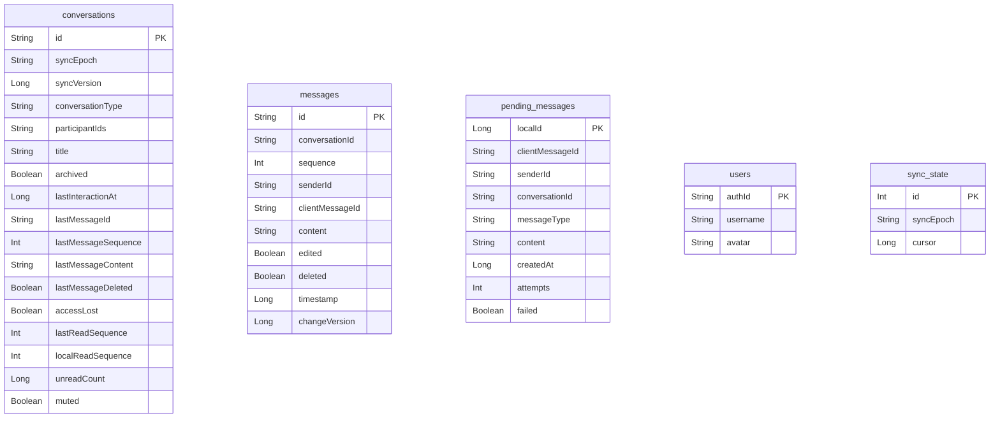

  

# Banco local

O SQLite local usa Room e pertence ao aplicativo. Guarda cache de conversas humanas e fila de envio, sem ser fonte de verdade do cadastro ou do serviço de mensagens. A versão é 3, com cinco entidades e `exportSchema=false`.

O módulo define o nome físico do banco e usa `fallbackToDestructiveMigration(true)`. Não declara migração de preservação. Confirmar o ciclo de atualização e retenção. <!-- PENDENTE: 1 -->

## Estrutura

O diagrama lista os campos do schema. Referências entre identificadores são lógicas. As entidades não declaram chaves estrangeiras.

## Tabelas e índices

| Tabela | Chave e índices explícitos | Conteúdo e acesso |
|---|---|---|
| `conversations` | PK `id` | Tipo, participantes, prévia, época, versão, acesso e estado pessoal. Sincronização e estado escrevem. Lista e chat leem |
| `messages` | PK `id`, índice único em `conversationId, sequence` | Mensagens humanas, versão, edição e tombstone. MessageStore aplica merge e a tela observa |
| `pending_messages` | PK autogerada `localId`, índice único `clientMessageId`, índice `senderId, conversationId` | Texto, destino, remetente, tentativas e falha. Outbox grava antes do POST e remove após confirmar ou descartar |
| `users` | PK `authId` | Nome e avatar do chat. UserDirectory preenche pelo cadastro central |
| `sync_state` | PK `id`, uma linha convencionada como zero | Época e cursor. Somente catch-up avança o cursor |

São três índices explícitos além das chaves primárias. `conversationId` referencia logicamente `conversations.id`. `senderId` é uma identidade que pode não ter linha em `users`. `clientMessageId` associa pendência e confirmação. Não há cascata relacional declarada.

## Leitura e escrita

Mensagens são ordenadas por `sequence`. O merge transacional aceita versão mais nova e remove conteúdo na exclusão. Conversas usam época e versão para descartar eventos antigos. O cursor é gravado depois da aplicação da página, permitindo reaplicação após interrupção.

`localReadSequence` é a leitura no aparelho. A diferença para `lastReadSequence` representa pendência sem tabela de fila. A contagem exibida fica zero quando a pessoa já viu a última mensagem localmente.

Chatbots podem ter linha na lista, mas suas mensagens não ficam no cache persistente. DataStore guarda a sessão fora destas tabelas, com tokens cifrados pelo Keystore.

## Ciclo dos dados

Logout ou troca de conta limpa todas as tabelas. Perda de acesso mantém conteúdo local em leitura. Mudança de época limpa mensagens e cursor e refaz sincronização, mantendo pendências. Migração destrutiva pode perder também a fila, portanto cache recuperável e mensagem não enviada têm riscos diferentes.

Não foi encontrada limpeza por TTL ou limite de histórico nesse caminho. A sincronização tenta completar o histórico humano até o início, sem comprovar teto de armazenamento. <!-- PENDENTE: 1 -->

Fontes em [entidades e DAOs](https://github.com/Solierrr/mobile-app/tree/main/app/src/main/kotlin/com/project/solaria_mobile/core/database), [registro das entidades](https://github.com/Solierrr/mobile-app/blob/main/app/src/main/kotlin/com/project/solaria_mobile/core/database/AppDatabase.kt), [abertura](https://github.com/Solierrr/mobile-app/blob/main/app/src/main/kotlin/com/project/solaria_mobile/di/DatabaseModule.kt) e [sincronização](https://github.com/Solierrr/mobile-app/blob/main/app/src/main/kotlin/com/project/solaria_mobile/feature/communication/data/MessageSync.kt).
