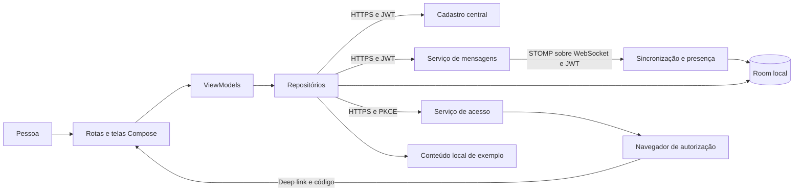

  

# Arquitetura

Aplicativo de um módulo Gradle `:app`, em Kotlin e Jetpack Compose, organizado por feature. Hilt injeta repositórios, ViewModels expõem StateFlow e rotas coletam estado com o ciclo de vida. Screens recebem dados e callbacks sem controlar o NavController.

## Organização

Os caminhos são relativos à raiz Kotlin do aplicativo.

| Caminho | Papel |
|---|---|
| `App.kt` | Inicia fila, sincronização, leitura e ciclo STOMP |
| `MainActivity.kt` | Raiz Compose e callback |
| `presentation/navigation/` | Destinos serializáveis e NavHost |
| `core/auth/` | PKCE, tokens, Keystore e renovação |
| `core/network/` | Retrofit, OkHttp, erros, conectividade e STOMP |
| `core/database/` | Entidades, DAOs e merge |
| `core/designsystem/` | Tema e componentes |
| `feature/` | Estado, domínio, telas e dados por área |
| `di/` | Instâncias de rede, banco e APIs |

## Integrações

| Relação | Protocolo | Autenticação |
|---|---|---|
| Autorização e troca do código | HTTPS JSON e navegador | PKCE S256, state e código |
| Cadastro central | HTTPS REST | Bearer JWT |
| Mensagens e estado de conversa | HTTPS REST | Bearer JWT |
| Eventos e presença | STOMP sobre WebSocket | Bearer no CONNECT |
| Geocodificação no QA | HTTPS JSON | Cliente da sessão |
| Imagens públicas | HTTPS | Cliente sem interceptor de sessão |
| Identificador de instalação | Firebase Installations | Configuração Firebase da variante |

O contexto está em [login e token](https://github.com/Solierrr/docs-warehouse/blob/main/docs/flows/LOGIN_AND_TOKEN.md). O app não usa `X-Service-Key`. A autorização de recurso pertence aos servidores.

## Sessão

`RemoteAuthRepository` gera verifier e state e inicia a transação. O callback consome a pendência uma vez e compara state antes de trocar o código. Access e refresh tokens ficam cifrados no DataStore com AES-GCM e chave de 256 bits no Android Keystore. O verifier também é cifrado.

OkHttp envia o token e usa `TokenAuthenticator` após 401. A renovação é sincronizada, reutiliza token já atualizado por outra chamada e limita a cadeia de respostas. Recusa de refresh limpa a sessão. IOException de rede ou falha 5xx propaga sem se converter automaticamente em recusa de credencial. Claims lidos localmente não substituem validação no servidor.

## Dados e sincronização

O Room guarda cinco tabelas em [SQLITE.md](../database/SQLITE.md). O banco próprio contraria a hipótese inicial do checklist. A versão atual é 3, com migração destrutiva de contingência. Preservação da fila entre versões precisa de decisão. <!-- PENDENTE: 1 -->

Eventos e catch-up usam versões. O cursor só avança por catch-up. Mudança da época do servidor limpa mensagens e cursor e refaz bootstrap, preservando a fila nesse caminho.

O worker da fila vive no escopo da aplicação. Não há WorkManager. Envio eventual depende de processo ativo e conexão, sem promessa de entrega após encerrar o app.

## Observabilidade e versão

Diagnóstico e estados de rede distinguem sessão, servidor e conectividade. O parser converte status HTTP para `ErrorKind` e extrai `errors[].field`. Não traduz todo `errorCode` de negócio.

Gradle declara `versionName` 1.0 e `versionCode` 1, com sufixo no QA. A versão distribuída não foi inferida da tag antiga do checklist. <!-- PENDENTE: 3 -->

A revisão analisada é `b6419552`, em 2026-10-30. Fontes em [Gradle](https://github.com/Solierrr/mobile-app/blob/main/app/build.gradle.kts), [navegação](https://github.com/Solierrr/mobile-app/blob/main/app/src/main/kotlin/com/project/solaria_mobile/presentation/navigation/AppNavHost.kt), [autenticação](https://github.com/Solierrr/mobile-app/blob/main/app/src/main/kotlin/com/project/solaria_mobile/feature/auth/data/RemoteAuthRepository.kt), [renovação](https://github.com/Solierrr/mobile-app/blob/main/app/src/main/kotlin/com/project/solaria_mobile/core/auth/TokenAuthenticator.kt) e [sincronização](https://github.com/Solierrr/mobile-app/blob/main/app/src/main/kotlin/com/project/solaria_mobile/feature/communication/data/MessageSync.kt).
