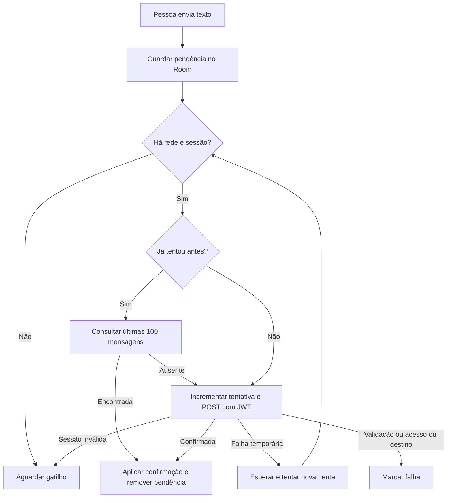

  

# Envio de mensagens

A mensagem é persistida antes do envio e sai da fila ao confirmar ou descartar.

## Falhas e limites

Rede, 5xx, 429 ou conflito permite repetição com espera de 15, 30, 60, 120 e até 240 segundos. Validação, 403 ou 404 marca falha sem travar outras mensagens. A pessoa pode tentar ou descartar. Consultar só histórico recente não garante envio único. <!-- PENDENTE: 5 -->

Fonte em [implementação](https://github.com/Solierrr/mobile-app/blob/main/app/src/main/kotlin/com/project/solaria_mobile/feature/communication/data/MessageOutbox.kt).
