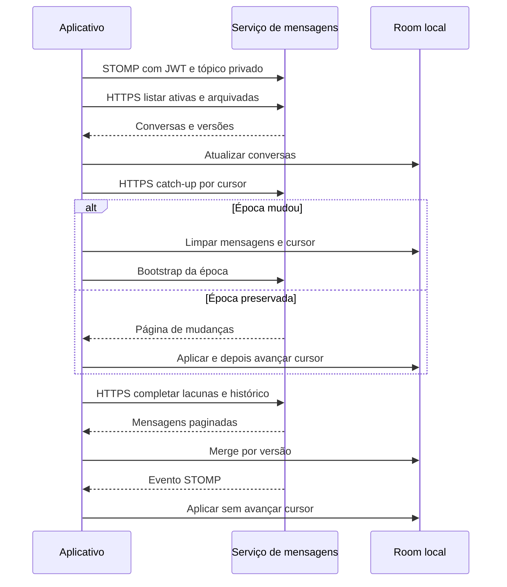

  

# Sincronização do histórico

O processo combina eventos ao vivo, catch-up por cursor e reparo de histórico humano.

## Falhas e limites

Falha com rede agenda sincronização em 30 segundos. Sem rede, aguarda gatilho. Chatbots e conversas sem acesso não recebem reparo humano. Uma página que não muda o resumo encerra o reparo para evitar laço. O contexto está em [comunidade de projeto](https://github.com/Solierrr/docs-warehouse/blob/main/docs/flows/PROJECT_COMMUNITY.md).

Fonte em [implementação](https://github.com/Solierrr/mobile-app/blob/main/app/src/main/kotlin/com/project/solaria_mobile/feature/communication/data/MessageSync.kt).
