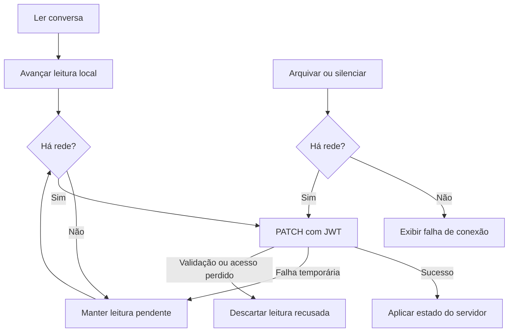

  

# Leitura e preferências

A leitura é guardada sem rede. Arquivar e silenciar exigem conexão.

## Falhas e limites

O worker de leitura repete em 30 segundos ou por gatilho. O cursor local pode zerar a contagem exibida antes da confirmação. Estado pessoal não usa tabela de fila adicional.

Fonte em [implementação](https://github.com/Solierrr/mobile-app/blob/main/app/src/main/kotlin/com/project/solaria_mobile/feature/communication/data/ConversationStateSync.kt).
