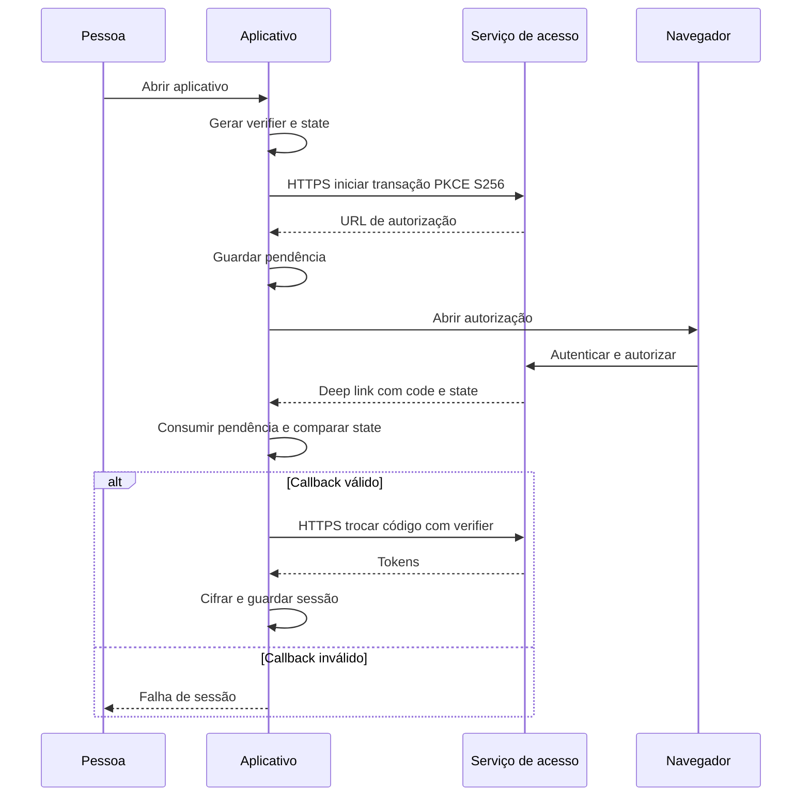

  

# Login pelo navegador

Ao abrir sem sessão, o aplicativo inicia autorização no navegador e recebe código e state no callback.

## Falhas e limites

Um code ou state ausente, uma pendência inexistente ou um state diferente impedem a troca, e a pendência só pode ser consumida uma vez, cabendo ao servidor decidir a validade do código e a elegibilidade. O contexto está em [login e token](https://github.com/Solierrr/docs-warehouse/blob/main/docs/flows/LOGIN_AND_TOKEN.md).

Fonte em [implementação](https://github.com/Solierrr/mobile-app/blob/main/app/src/main/kotlin/com/project/solaria_mobile/feature/auth/data/RemoteAuthRepository.kt).
