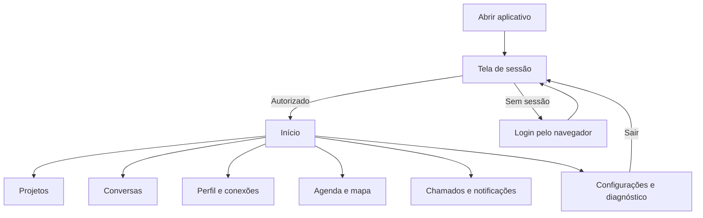

  

# Navegação principal

A sessão determina a entrada e a navegação tipada abre as áreas do aplicativo.

## Falhas e limites

Remoção da sessão leva à entrada e limpa a pilha. Uma rota não comprova integração de toda a área. Atalhos da lista de conversas ainda incluem ids de exemplo.

Fonte em [implementação](https://github.com/Solierrr/mobile-app/blob/main/app/src/main/kotlin/com/project/solaria_mobile/presentation/navigation/AppNavHost.kt).
